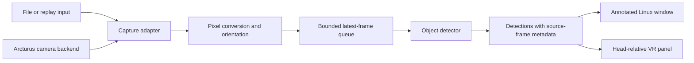
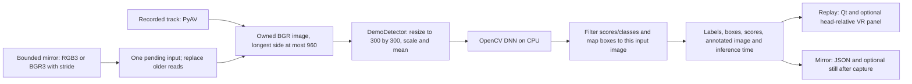

# Architecture and roadmap

Framejacker separates input, inference and presentation so a new camera backend
can feed the existing detector and display. The implemented replay path selects
one recorded track with PyAV, runs MobileNet-SSD on CPU and presents an annotated
image in Qt and, optionally, a native OpenVR panel. A separate bounded mirror
recognizer now reuses that CPU detector without starting a live display; its
first Frame trial processed about five reads per second with normal passthrough.
Continuous display and feedback exclusion remain separate acceptance steps.

[Status and evidence](status.md) owns capability and validation results.
[Live capture](live-capture.md#current-work-order) owns current tasks; this page
describes design and long-term acceptance criteria. The
[camera reference](steam-frame-camera.md) documents interface constraints and
the [dated source review](capture-reference-review.md) explains capture choices.

## Frame processing



Keep capture, inference, and presentation separate so a new camera backend does
not require a different detector or renderer. A slow detector should discard old
queued frames rather than accumulate latency. Preserve the source frame until
its detections have been drawn; drawing detections over a newer frame can
misplace labels.

| Component | Proposed responsibility |
| --- | --- |
| Capture adapter | Read replay files or a selected hardware backend; report unavailable devices, disconnects, and idle states explicitly |
| Frame metadata | Carry dimensions, stride, pixel format, camera identity, orientation, timestamp/timebase provenance, optional producer sequence, calibration reference, and pose validity |
| Preprocessing | Convert the actual source format to the model's input; retain crop/resize transforms so detections map back to source pixels |
| Detector | Prototype: MobileNet-SSD through OpenCV DNN on CPU; select a production model/runtime using device measurements |
| Presentation | Prototype: annotated Qt replay window and optional native OpenVR panel; both confirmed working on Frame by the user |

Choose the model, input size, execution provider, and update rate using measured
accuracy and latency. CPU execution in the cloud does not establish the same
runtime or performance on the headset. Model weights, labels, preprocessing,
and license must be recorded together for reproducible results.

## Recognition implementation and model replacement

The implemented detector is [`DemoDetector`](../scripts/demo_detector.py), shared
by file replay and the bounded mirror recognizer. It loads SHA-256-verified
MobileNet-SSD Caffe weights/configuration into OpenCV DNN, explicitly selects
CPU execution and limits OpenCV to two threads. It recognizes the 20 Pascal VOC
foreground classes plus a background output; it has no rug class. A rug labeled
sofa is a false positive, not evidence that rug recognition is supported.



Replay converts its selected decoded track to BGR24 and scales it to at most
960 pixels on the longest side. The mirror path handles padded RGB3/BGR3 reads,
converts to BGR and uses the same limit. The detector requires a nonempty
`uint8` image with three BGR channels. Its `blobFromImage` uses a 300 × 300
resize, scale `0.007843` and mean `127.5`; this resize stretches the image,
rather than adding letterbox padding. SSD's normalized boxes are mapped back
to the dimensions of that specific input image, clamped and drawn on an owned
copy. The default score threshold is 0.5. Scores are not calibrated
probabilities or a measured accuracy percentage.

The current adapter boundary is an ordinary Python method:

```python
result = detector.detect(bgr_image, threshold)
# result contains:
# image: owned annotated uint8 BGR image matching this input
# labels: sorted label strings
# detections: [{"label": str, "confidence": float, "box_xyxy": [x1, y1, x2, y2]}]
# inference_ms: time spent in the model's forward call
```

Both callers currently construct `DemoDetector` directly; there is no model
selector or second detector adapter yet. The mirror worker already accepts an
injected detector factory for tests. Replay presents one latest completed
result, while mirror capture keeps one pending owned input for inference and
drops observations older than one second. The measured 42.044 ms mean forward
time and roughly 5 processed fps belong to the bounded mirror/MobileNet trial,
not to a replacement model or a full live VR pipeline.

### Candidate models

These are candidates to evaluate, not installed backends or Frame benchmarks.
The exact weights, export graph and redistribution terms must be checked when
selecting an artifact; a repository license alone does not settle every weight's
terms.

| Candidate | Why consider it | Runtime and tradeoff |
| --- | --- | --- |
| Current MobileNet-SSD | Small working baseline with measured Frame execution | OpenCV DNN CPU; only 20 foreground classes and observed false positives |
| [YOLOX-Nano](https://github.com/Megvii-BaseDetection/YOLOX) | First compact alternative to compare on indoor objects; standard COCO training covers 80 classes | Export/pin ONNX, implement its preprocessing, output decoding and NMS, test OpenCV DNN or ONNX Runtime CPU; source uses Apache-2.0 |
| [YOLO11n](https://docs.ultralytics.com/models/yolo11/) | Another small 80-class COCO detector with an established export workflow | Export off-device instead of requiring the training stack on Frame; verify ONNX operators/runtime and AGPL-3.0 or applicable commercial licensing |
| [EfficientDet-Lite0](https://ai.google.dev/edge/litert/libraries/task_library/object_detector) | A mobile-oriented alternative, including quantized deployment | Requires a LiteRT/TFLite adapter and verified ARM64 runtime; quantized accuracy and preprocessing need measurement |
| [Grounding DINO](https://github.com/IDEA-Research/GroundingDINO) or [OWLv2](https://huggingface.co/docs/transformers/model_doc/owlv2) | Text-prompted categories such as rug/carpet without the current fixed label list | Much heavier candidates; begin with offline evaluation or an explicit companion-computer experiment before headset deployment |
| A small detector fine-tuned for our target objects | Best route if rugs or a specific set of household objects are essential | Collect/label representative color and grayscale camera images, retain a held-out test set and export a compact model; training happens off-device |

COCO's 80 classes also omit rug/carpet. Switching to a COCO model alone will not
add that category. Use suitable custom training or test an open-vocabulary model
if naming rugs is a requirement. Segmentation models can add object outlines;
a generic segmenter does not automatically supply correct object names. Gaussian
splats concern scene reconstruction and do not replace the detector.

### Replacement procedure

1. Agree on target classes and an annotated evaluation set from representative
   recordings/stills, including rugs and objects previously confused. Measure
   correct classes, missed objects, false positives and box placement.
2. Add a detector adapter that preserves the method/result boundary above.
   Pin weights and label-map hashes, input dtype/shape, RGB/BGR order,
   normalization, model/runtime versions and licenses. Add the runtime only to
   environments that use it. ONNX Runtime is present in the cloud smoke setup;
   it is not currently a replay dependency or a recognition backend.
3. Perform the new model's own preprocessing/output decoding, score filtering
   and NMS where needed. Invert any letterbox/crop/resize transform before
   returning boxes. Keep the original frame association and owned output image;
   changing a weight filename alone is insufficient.
4. Introduce a shared factory/model selection for both callers and retain
   MobileNet-SSD as the comparison baseline. Test decoding, class IDs, finite
   scores, coordinate transforms, empty results and shutdown with the adapter.
5. Compare the models on the same inputs, then benchmark ARM64 startup, memory,
   preprocessing/inference/render times, input age, thermals and passthrough
   behavior. Begin at the existing 5 processed fps target; drop older pending
   input instead of accumulating latency.

CPU is the established inference backend. An ARM64 CPU ONNX runtime or an
[ncnn Vulkan](https://github.com/Tencent/ncnn) adapter is a possible later
deployment choice, subject to graph support and measurement. Vulkan capture
capability does not establish fast or compatible model inference, and GPU
inference may contend with capture and compositing on the headset. Benchmark
capture alone before adding it.

Dedicated input is currently a metadata-only inspection adaptation. The layer
retains/exports no image FDs and raw capture remains blocked because the
[producer synchronization review](live-capture.md#producer-synchronization-review-and-next-checkpoint)
found no coordinated access interval. A future backend must publish an owned
copy obtained through a supported frame lease or inside a verified synchronized
compositor access window. Only then should it feed the latest-frame queue.
Connecting grayscale luma to recognition remains work: replicating luma into three
channels satisfies the detector's input shape but does not recover color or
establish accuracy for a model trained on color images.

## Camera backend boundary

The standalone mirror recognizer uses the verified virtual SteamVR reader in
a supervised process. Capture and inference run separately with one pending
read; newer captured input replaces pending input when processing falls behind.
Each result retains its own image, local read count and observation time. RGB3
and BGR3 are converted explicitly, including stride padding, before the shared
`DemoDetector` runs. This is composited input, with no exposure timestamps or
verified physical-camera identity. The fixed-panel device test confirmed that
this mirror includes our VR output. Keep it for bounded/no-display recognition
and post-capture snapshots; continuous VR image output should use input before
overlay composition or a supported exclusion mode verified on the device.
No such alternate mirror mode is implemented or validated.

The [public-probe result](status.md#e3-public-camera-probe) prevents treating
OpenVR interface availability as evidence of frame access on the tested runtime.
Community code provides an experimental Vulkan buffer-sharing reference rather
than a vendor-supported live capture contract. Keep provider selection behind
the capture boundary so those constraints do not change inference or display.

The cited community capture tool outputs downscaled luma, not a ready-made color
RGB stream. Its observation-time estimates are not exposure timestamps and do
not guarantee stereo synchronization. Keep such a backend optional until its
format, synchronization, lifecycle, and impact on tracking/compositing have been
measured. Do not assume the accessory is a generic USB webcam or open physical
camera nodes already owned by XRService. Details and sources are in the
[camera guide](steam-frame-camera.md#experimental-live-capture).

## Presentation and spatial labels

`scripts/replay_window.py` implements the first window prototype. A worker thread
owns PyAV decoding, resizing and CPU inference, then publishes one latest
completed annotated image under a lock. The Qt thread copies that image into
an owned QImage and paints it with aspect ratio preserved. Each annotation
belongs to the image it was inferred from; queued results do not accumulate.
The worker checks pause/replay/stop events and closes the file between loops.
Playback processes each frame at up to 10 fps by default, rather than promising
the recording's original timing. The UI offers pause/resume, replay and looping.

Optional `--overlay` sends the same completed annotated image to a separate
native process owning a public OpenVR overlay. A sender thread retains one
pending RGBA image and sends settings independently of replay frames, keeping
the GUI responsive while paused or while native writes are blocked. The panel
follows the HMD; no calibrated world-space transform is implied. See the
[overlay guide](vr-overlay.md) for transport, cleanup and the timed test for a
new device or runtime. Cloud validation exercises the same parser without
OpenVR and does not establish headset rendering.

A regular window or VR panel can display an image with 2D detections without
establishing its position in the room. The
[presentation evidence](status.md#e6-window-and-vr-panel) records device results
and remaining measurement limits.

Labels anchored to objects in the world require additional geometry: calibrated
intrinsics/distortion, camera-to-head transforms, object depth, and a headset pose
matched to the frame's timestamp. Preserve pose and timing validity explicitly.
A 2D bounding box alone does not provide a world position, and an unsynchronized
stereo pair does not establish reliable depth.

## Optional offline Gaussian splats

Treat splats as a separate scene reconstruction experiment. Preserve original
Arcturus camera-app stereo recordings and their calibration/pose metadata, then
evaluate the documented reconstruction workflow on a suitable GPU computer.
Start with mostly static scenes and assess viewing on Frame separately.

The diagnostic recorder described in community research is a different source:
it provides calibration and stereo snapshots, but its continuous video is one
SLAM camera. Neither that recording nor the generated smoke-test video replaces
the camera app's stereo recording format. See the
[recording and splat workflow](steam-frame-camera.md#calibration-spatial-labels-and-gaussian-splats).
Splats reconstruct scene appearance; live object recognition still needs the
detector. Splat training, headset rendering, and semantic splat integration have
not been validated here.

## Milestones and acceptance checks

These are acceptance criteria, not a second status matrix or current task list.
See [status](status.md) for completed evidence and
[live capture](live-capture.md#current-work-order) for the active sequence.

1. **Replay and window:** process a known recording, verify detection coordinates
   and frame association, open the window on a real display, and check clean
   shutdown. Headless smoke rendering is useful dependency validation, but does
   not complete the interactive window check.
2. **Live capture:** select a usable backend based on the documented headset
   findings, and verify real frames, pixel conversion, camera
   identity/orientation, disconnect/reconnect, and wake/idle behavior. Record
   SteamOS/SteamVR versions and timing provenance.
3. **VR panel:** verify visible playback, controls and head-relative placement.
   Measure label readability, processing rate, resource use and tracking/compositor
   behavior during the intended VR workload. Measure end-to-end latency and
   frame drops when a live backend is available.
4. **World-space labels:** validate calibration, depth, pose timing, and label
   placement against known geometry while the headset and objects move.
5. **Optional splat experiment:** reconstruct a recorded static scene, inspect its
   geometry/appearance, and measure the exported scene's rendering on Frame.

Keep each milestone's evidence separate. A successful environment smoke check
does not imply a passed hardware, VR, or reconstruction milestone.
