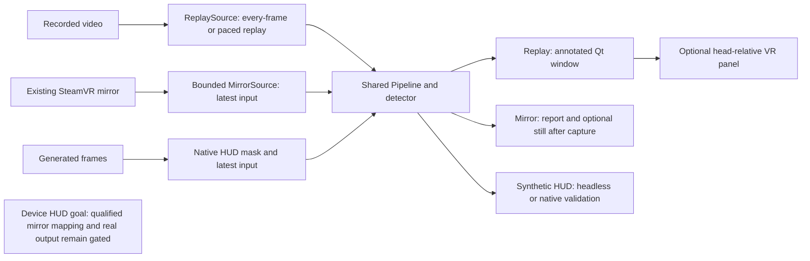

# Architecture

SightCircuit turns recorded or captured images into object names and boxes.
Input, detection and presentation are separate components, so they share a
recognition engine while retaining different operating limits.

Start here for the design. Use [development](development.md) to build it,
[status](status.md) for verified capabilities, and [current work](live-capture.md)
for remaining work. A **head-relative** panel follows the wearer's view; a
**world-locked** label would stay attached to a location in the room.

## Frame processing

Three paths exist today. Solid arrows below show implemented paths; the last
box describes the device HUD goal, whose production gates remain closed.

`FrameSource` supplies owned images and source metadata. `Pipeline` converts
pixels, calls the selected `Detector`, and sends matching results to a `Sink`.
Replay and bounded mirror recognition share this engine. The HUD stage masks
its reserved image region before resizing or inference.

A result always belongs to its original frame. Latest-only processing keeps
one pending input and replaces old input when inference is slower than capture.
Observation time records when the application read a frame; it is not a camera
exposure timestamp. See the [pipeline reference](development.md#python-package-and-pipeline)
for interfaces and module layout.

## Fixed edge HUD decision

The active proof of concept shows up to three object names and approximate
direction arrows in a fixed, head-relative tile at the lower-right edge of the
view. It shows no scene video or world-space labels. The [scope and accepted
decisions](poc-scope.md) own this choice.

The mirror includes our VR output, so the detector must not see the HUD's own
pixels. Before resizing, the HUD stage masks the full footprint, its margin,
and every qualified eye copy at native resolution. It then fills that region
from surrounding scene pixels. The covered region is a blind region where
objects cannot be reliably presented.

The mapping binds the source, session, runtime, tracking origin, image format
and HUD configuration. Changed or expired context stops inference and output;
stale content expires from its original frame time, independently of inference.
Only synthetic calibrations are accepted today. Real mirror input with the HUD,
hardware mapping and real expiring HUD output remain closed in code.

The [qualification design](hud-qualification.md) explains the missing device
evidence. Current [HUD runtime](reference/hud-runtime.md),
[candidate records](reference/hud-candidates.md), [session identity](reference/hud-session.md)
and [observation tools](reference/hud-observation.md) have separate references.
A clean marker observation is still **unqualified**: it cannot establish eye
identity, hidden copies or feedback exclusion by itself.

## Recognition implementation and model replacement

MobileNet-SSD is the default CPU detector. YOLOX-Nano is an implemented
alternative. Models preserve their own labels; evaluation maps them to common
names when appropriate. Neither model has a rug class. A successful command
or a single detected object does not establish broad detection accuracy.

The [detection reference](reference/detection.md) documents preprocessing,
coordinates, the detector interface and the model-replacement procedure.

### Candidate models

See [implemented models and later candidates](reference/detection.md#candidate-models).

### Replacement procedure

See [adding and evaluating a detector](reference/detection.md#replacement-procedure).
Keep representative Frame evaluation separate from the public regression set.

## Camera backend boundary

The working live input is a bounded read from the existing SteamVR composited
mirror. Its physical camera identity, exposure timing and calibration are not
established. It can include our output. A captured-image panel therefore needs
its own exclusion solution; the HUD instead depends on a qualified footprint
mask and feedback validation.

Dedicated camera capture is a deferred, paused track. Its experimental provider
allows metadata inspection only; no synchronized ownership contract permits
pixel reads. A future provider must expose an owned copy through a supported
frame lease or a verified synchronized compositor access window. It is not a
prerequisite for the current HUD path. See the [camera reference](steam-frame-camera.md)
and [provider research](live-capture.md#producer-synchronization-review-and-next-checkpoint).

## Presentation and spatial labels

The replay window receives completed annotated frames from a worker. The Qt
thread owns its displayed image, and an optional sink sends that same result
to a separate OpenVR bridge process. The panel follows the headset and can be
positioned through the [overlay controls](vr-overlay.md).

World-locked labels would require calibrated camera geometry, depth and a
headset pose aligned to the frame's timebase. A 2D box supplies none of those.
They remain deferred until the fixed HUD proof of concept is accepted.

## Optional offline Gaussian splats

Gaussian splats reconstruct scene appearance from recordings; they do not
replace object detection. Reconstruction and headset viewing remain a separate,
unvalidated future experiment. The [camera reference](steam-frame-camera.md#calibration-spatial-labels-and-gaussian-splats)
retains the researched recording workflow.

## Planned structure (2026-11-07)

The [architecture decisions of 2026-11-07](poc-scope.md#architecture-decisions-2026-11-07)
shape the next changes. This section separates what the checkout implements
today from what the plan adds. Nothing below is implemented unless it says so,
and every production gate stays closed until its acceptance row passes.

### Supervision and lifecycle

Child supervision and signal handling existed in six places: the runtime
guard (the only one that reaps a whole process group), the bounded worker in
`runtime/process.py`, the agent runner, the paused capture supervisor, the
overlay client and the shared-memory check. They differ in grace periods, in
whether a signal raises or is recorded, and in how an inherited ignored signal
is treated. The plan replaces them with one primitive in `sightcircuit/runtime`,
seeded from the guard: owned-session spawning, a hold-and-arm protocol around
process start, group termination with reaping, deadline-based cleanup verdicts,
a declared policy for inherited signal dispositions, progress streaming and one
report block. **Implemented so far:** the primitive itself,
[`runtime/supervision.py`](reference/pipeline.md#the-supervision-primitive),
and the guard on it (work-order item B3), with an arm handshake that closes
the window in which a cancellation reached a worker before its handlers were
installed; the agent runner on it (B4: its raise-mode signal policy with an
inherited ignore honoured, and the primitive's group termination with reaping,
the runner being its tasks' subreaper), and the agent package as its own
checkpoint-manifest group (decision D7). Adoption by the live pipeline and the
mirror launcher, then the capture supervisor remains planned (B5, B6).

### Native bridge

The bridge in `tools/overlay_bridge.cpp` carries connection lifecycle, overlay
rendering, the marker, context sensing, a watchdog and report assembly in one
source file. It may end itself on its watchdog or on parent death; the Python
side owns escalation and the cleanup verdict. The plan splits the source into
lifecycle, rendering, reporting and sensing units, moving the tests and manifest
pins that name the file, before the tracking reporter is integrated behind its
flag. Without the flag the bridge makes no new OpenVR call.

### Approval tiers

The [gate table](../sightcircuit/gates.py) has three production gates, all
closed. The plan adds a second, equally closed table for a diagnostic tier: a
scope record issued only by a factory, bound to the checkpoint manifest, the
mapping record and model digests, with an absolute deadline and a consumed run
identifier. Each gated call site then permits a use when its synthetic
condition holds or a valid scope permits that gate. The diagnostic tier's mask
is the union of every observed marker copy plus the margin, so eye identity is
not required for the acceptance run; the capture layout must still be declared.
Two record changes come first: the calibration record must carry the mirror's
native format metadata, which until record version 2 made every real mirror
frame unrepresentable (implemented on 2026-11-07, item A6;
[record versions](reference/hud-candidates.md#record-versions)), and the
candidate conversion needs the tracking tokens the reporter supplies. The
rest is a design; no diagnostic command exists.

### Commands and packaging

Implemented on 2026-11-07 (P1, P2): one hashed lock per requirement set,
installed by the setup scripts; the bodies of the ten active commands in
`sightcircuit/commands/`, each `scripts/<name>.py` a thin wrapper that is the
body module when imported and runs it when executed, and a `sightcircuit-<name>`
console entry point per command. The two commands that re-spawn a worker do so
by their own file path, the validators keep resolving by dotted name under
`sightcircuit`, and the checkpoint manifest pins the wrappers by name and the
bodies as package modules ([details](development.md#commands-and-entry-points-2026-11-07)).

### Operations tooling

`sightcircuit/agent` (guard, runner, tasks) and the installer run tasks on the
Frame. They are outside the production gates: no gate claim, their own group in
the checkpoint manifest, their own evidence records and their own test timing
budget. Their design is in [agent-on-Frame](agent-on-frame.md).

### Detector evaluation

The evaluation harness scores presence and, when boxes are supplied,
per-object matches, with box recall per label as well as overall; the manifest
helper enters boxes (`--object`, `--boxes-complete`) while the device session
script still collects presence labels only. The POC threshold and the live
budget are one named constant each in `sightcircuit/detection.py`
([reference](reference/detection.md#poc-threshold-and-live-budget)), a test
checks that the private still directory stays ignored, and the evaluation
report names inputs by basename only (implemented, work items C1 to C4). The
representative set is built and scored on the Frame; only JSON leaves it.

### Fallback input design

If the marker-observation budget is exhausted, the plan switches to
time-multiplexed exclusion: the bridge hides the HUD, the mirror is read only
after a device-measured bound, the frame is admitted only if it differs from
the last pre-hide frame, and the HUD is shown again after the window. It reuses
the mirror source, latest-frame handling, the tile renderer and the bridge's
show and hide, and bypasses the mask, mapping and qualification stack. It needs
new bridge events with timestamps, an admission window in the pipeline and
device evidence for hide-to-absence latency and loopback repeat behaviour. Its
costs are HUD duty cycle and flicker. It is designed and costed in the
[fallback reference](reference/hud-fallback.md) (item A11, 2026-11-07), from
the draft in the
[council record](history/2026-11-07-architecture-council.md#fallback-time-multiplexed-exclusion),
and not built.

## Milestones and acceptance checks

Use the [current work and gates](live-capture.md#edge-hud-acceptance-gates)
for the active sequence and [POC acceptance](poc-scope.md#acceptance) for success
criteria. The [historical milestones](history/architecture-2026-11-07.md#milestones-and-acceptance-checks)
retain the earlier replay, panel, world-space and reconstruction acceptance notes.

## Progress summary

<!-- BEGIN progress-summary: generated by scripts/generate_status.py; edit docs/status-data.json and docs/evidence/ -->
Generated from reviewed capability rows and per-entry evidence. The
[historical dashboard](https://claude.ai/artifact/XNPpBHVFUy5Q8JQV9aLaKq)
was a dated snapshot; this table has a reproducible repository source.
[Status](status.md) owns evidence and
[live capture](live-capture.md#current-work-order) owns current work.

| Area | State | Evidence and limits |
| --- | --- | --- |
| Annotated Qt replay window | Device-confirmed | E47 reports 576 frames and reports four labels; label accuracy remains unevaluated; [E47](status.md#e47-recorded-recognition-and-vr-panel-poc-on-frame) |
| Bounded mirror recognition | Rewritten path re-run on Frame; broader accuracy open | The November 3 rerun had labels matching the owner’s view ([E81](status.md#e81-catch-up-session-on-frame-regressions-400-frame-panel-run-mirror-and-wp2-stills)). [Earlier measurements, still export and limits](evidence/capability-notes.md#bounded-mirror-recognition). |
| Candidate detector and evaluation harness | E61 miss reproduced; Frame model choice open | The original still and digest were verified on Frame; the miss remains unexplained ([E80](status.md#e80-file-only-detector-re-run-on-the-e61-still-with-audit-variants)). Five unboxed stills support the chair demo, not a model default. [Evaluation details](evidence/capability-notes.md#candidate-detector-and-evaluation-harness). |
| Fixed edge HUD, marker and offline live pipeline | Offline validation passed; G2 closed; G3 open | The owner accepted rehearsed recovery; the green-input cause is unknown ([E79](status.md#e79-g2-green-input-log-analysis-and-recovery-rehearsal-on-frame)). G3 stopped before any marker ([E83](status.md#e83-g3-marker-observer-attempt-stopped-at-the-observer-scene-precondition)); the file-only analysis of the chair still on Frame predicts that the O3 precondition passes ([E88](status.md#e88-a2-file-only-still-analysis-on-frame-the-chair-still-passes-the-o3-precondition)), which is not an observation. Production gates stay closed; [implementation and limits](evidence/capability-notes.md#fixed-edge-hud-marker-and-offline-live-pipeline). |
| Stereo depth and world-space labels | Deferred | Calibration, depth and pose/timebase alignment remain unresolved |
| Gaussian splat reconstruction and viewing | Deferred optional work | Recorded-data workflow researched; training and headset splat rendering not validated by this project |

The fixed edge HUD has offline validation. Lifecycle acceptance, Frame
mapping observation/qualification, feedback exclusion, physical expiry and
the 60-second headset acceptance run remain separate gates. World-locked
labels, dedicated capture, depth and splats stay deferred.
<!-- END progress-summary -->
