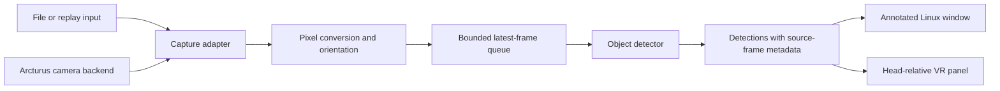

# Architecture and roadmap

Framejacker separates input, inference and presentation so a new camera backend
can feed the existing detector and display. The implemented replay path selects
one recorded track with PyAV, runs MobileNet-SSD on CPU and presents an annotated
image in Qt and, optionally, a native OpenVR panel.

[Status and evidence](status.md) owns capability and validation results.
[Live capture](live-capture.md#current-work-order) owns current tasks; this page
describes design and long-term acceptance criteria. The
[camera reference](steam-frame-camera.md) documents interface constraints and
the [dated source review](capture-reference-review.md) explains capture choices.

## Frame processing

Keep capture, inference, and presentation separate so a new camera backend does
not require a different detector or renderer. A slow detector should discard old
queued frames rather than accumulate latency. Preserve the source frame until
its detections have been drawn; drawing detections over a newer frame can
misplace labels.

| Component | Proposed responsibility |
| --- | --- |
| Capture adapter | Read replay files or a selected hardware backend; report unavailable devices, disconnects, and idle states explicitly |
| Frame metadata | Carry dimensions, stride, pixel format, camera identity, orientation, timestamp/timebase provenance, optional producer sequence, calibration reference, and pose validity |
| Preprocessing | Convert the actual source format to the model's input; retain crop/resize transforms so detections map back to source pixels |
| Detector | Prototype: MobileNet-SSD through OpenCV DNN on CPU; select a production model/runtime using device measurements |
| Presentation | Prototype: annotated Qt replay window and optional native OpenVR panel; both confirmed working on Frame by the user |

Choose the model, input size, execution provider, and update rate using measured
accuracy and latency. CPU execution in the cloud does not establish the same
runtime or performance on the headset. Model weights, labels, preprocessing,
and license must be recorded together for reproducible results.

## Camera backend boundary

The [public-probe result](status.md#e3-public-camera-probe) prevents treating
OpenVR interface availability as evidence of frame access on the tested runtime.
Community code provides an experimental Vulkan buffer-sharing reference rather
than a vendor-supported live capture contract. Keep provider selection behind
the capture boundary so those constraints do not change inference or display.

The cited community capture tool outputs downscaled luma, not a ready-made color
RGB stream. Its observation-time estimates are not exposure timestamps and do
not guarantee stereo synchronization. Keep such a backend optional until its
format, synchronization, lifecycle, and impact on tracking/compositing have been
measured. Do not assume the accessory is a generic USB webcam or open physical
camera nodes already owned by XRService. Details and sources are in the
[camera guide](steam-frame-camera.md#experimental-live-capture).

## Presentation and spatial labels

`scripts/replay_window.py` implements the first window prototype. A worker thread
owns PyAV decoding, resizing and CPU inference, then publishes one latest
completed annotated image under a lock. The Qt thread copies that image into
an owned QImage and paints it with aspect ratio preserved. Each annotation
belongs to the image it was inferred from; queued results do not accumulate.
The worker checks pause/replay/stop events and closes the file between loops.
Playback processes each frame at up to 10 fps by default, rather than promising
the recording's original timing. The UI offers pause/resume, replay and looping.

Optional `--overlay` sends the same completed annotated image to a separate
native process owning a public OpenVR overlay. A sender thread retains one
pending RGBA image and sends settings independently of replay frames, keeping
the GUI responsive while paused or while native writes are blocked. The panel
follows the HMD; no calibrated world-space transform is implied. See the
[overlay guide](vr-overlay.md) for transport, cleanup and the timed test for a
new device or runtime. Cloud validation exercises the same parser without
OpenVR and does not establish headset rendering.

A regular window or VR panel can display an image with 2D detections without
establishing its position in the room. The
[presentation evidence](status.md#e6-window-and-vr-panel) records device results
and remaining measurement limits.

Labels anchored to objects in the world require additional geometry: calibrated
intrinsics/distortion, camera-to-head transforms, object depth, and a headset pose
matched to the frame's timestamp. Preserve pose and timing validity explicitly.
A 2D bounding box alone does not provide a world position, and an unsynchronized
stereo pair does not establish reliable depth.

## Optional offline Gaussian splats

Treat splats as a separate scene reconstruction experiment. Preserve original
Arcturus camera-app stereo recordings and their calibration/pose metadata, then
evaluate the documented reconstruction workflow on a suitable GPU computer.
Start with mostly static scenes and assess viewing on Frame separately.

The diagnostic recorder described in community research is a different source:
it provides calibration and stereo snapshots, but its continuous video is one
SLAM camera. Neither that recording nor the generated smoke-test video replaces
the camera app's stereo recording format. See the
[recording and splat workflow](steam-frame-camera.md#calibration-spatial-labels-and-gaussian-splats).
Splats reconstruct scene appearance; live object recognition still needs the
detector. Splat training, headset rendering, and semantic splat integration have
not been validated here.

## Milestones and acceptance checks

These are acceptance criteria, not a second status matrix or current task list.
See [status](status.md) for completed evidence and
[live capture](live-capture.md#current-work-order) for the active sequence.

1. **Replay and window:** process a known recording, verify detection coordinates
   and frame association, open the window on a real display, and check clean
   shutdown. Headless smoke rendering is useful dependency validation, but does
   not complete the interactive window check.
2. **Live capture:** select a usable backend based on the documented headset
   findings, and verify real frames, pixel conversion, camera
   identity/orientation, disconnect/reconnect, and wake/idle behavior. Record
   SteamOS/SteamVR versions and timing provenance.
3. **VR panel:** verify visible playback, controls and head-relative placement.
   Measure label readability, processing rate, resource use and tracking/compositor
   behavior during the intended VR workload. Measure end-to-end latency and
   frame drops when a live backend is available.
4. **World-space labels:** validate calibration, depth, pose timing, and label
   placement against known geometry while the headset and objects move.
5. **Optional splat experiment:** reconstruct a recorded static scene, inspect its
   geometry/appearance, and measure the exported scene's rendering on Frame.

Keep each milestone's evidence separate. A successful environment smoke check
does not imply a passed hardware, VR, or reconstruction milestone.
