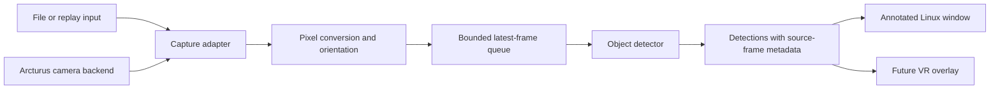

# Proposed architecture and roadmap

Framejacker's first application target is an annotated Linux window showing
objects detected in camera frames. The eventual target is a Steam Frame VR
overlay using the Arcturus Vision Camera. Initial tooling is for environment
smoke checks with generated or replayed inputs; it does not establish live camera
capture, application readiness, or headset compatibility. The application design
below is proposed, not an implemented capture or VR stack.

See [Steam Frame camera integration](steam-frame-camera.md) for pinned sources,
known interface limits, calibration requirements, and the device checks still
needed.

## Frame processing

Keep capture, inference, and presentation separate so a new camera backend does
not require a different detector or renderer. A slow detector should discard old
queued frames rather than accumulate latency. Preserve the source frame until
its detections have been drawn; drawing detections over a newer frame can
misplace labels.

| Component | Proposed responsibility |
| --- | --- |
| Capture adapter | Read replay files or a selected hardware backend; report unavailable devices, disconnects, and idle states explicitly |
| Frame metadata | Carry dimensions, stride, pixel format, camera identity, orientation, timestamp/timebase provenance, optional producer sequence, calibration reference, and pose validity |
| Preprocessing | Convert the actual source format to the model's input; retain crop/resize transforms so detections map back to source pixels |
| Detector | Run a selected object detection model through a suitable runtime, initially ONNX Runtime; return class, confidence, and image-space bounds |
| Presentation | Draw annotations in a regular window first; add a separately validated headset overlay backend later |

Choose the model, input size, execution provider, and update rate using measured
accuracy and latency. CPU execution in the cloud does not establish the same
runtime or performance on the headset. Model weights, labels, preprocessing,
and license must be recorded together for reproducible results.

## Camera backend boundary

Valve's public OpenVR tracked-camera interface is a candidate to probe on the
actual headset. Its existence does not demonstrate Arcturus support. Community
reports describe failed public camera probes and an experimental Vulkan path
that shares compositor camera buffers. Those reports are implementation
references, not a vendor-supported live capture contract.

The cited community capture tool outputs downscaled luma, not a ready-made color
RGB stream. Its observation-time estimates are not exposure timestamps and do
not guarantee stereo synchronization. Keep such a backend optional until its
format, synchronization, lifecycle, and impact on tracking/compositing have been
measured. Do not assume the accessory is a generic USB webcam or open physical
camera nodes already owned by XRService. Details and sources are in the
[camera guide](steam-frame-camera.md#experimental-live-capture).

## Presentation and spatial labels

A regular window or a VR panel can display the camera image with 2D detections.
This is the initial proof of concept. Overlay creation and rendering still need
testing on Steam Frame; Valve's general overlay examples do not prove device
compatibility.

Labels anchored to objects in the world require additional geometry: calibrated
intrinsics/distortion, camera-to-head transforms, object depth, and a headset pose
matched to the frame's timestamp. Preserve pose and timing validity explicitly.
A 2D bounding box alone does not provide a world position, and an unsynchronized
stereo pair does not establish reliable depth.

## Optional offline Gaussian splats

Treat splats as a separate scene reconstruction experiment. Preserve original
Arcturus camera-app stereo recordings and their calibration/pose metadata, then
evaluate the documented reconstruction workflow on a suitable GPU computer.
Start with mostly static scenes and assess viewing on Frame separately.

The diagnostic recorder described in community research is a different source:
it provides calibration and stereo snapshots, but its continuous video is one
SLAM camera. Neither that recording nor the generated smoke-test video replaces
the camera app's stereo recording format. See the
[recording and splat workflow](steam-frame-camera.md#calibration-spatial-labels-and-gaussian-splats).
Splats reconstruct scene appearance; live object recognition still needs the
detector. Splat training, headset rendering, and semantic splat integration have
not been validated here.

## Milestones and acceptance checks

1. **Replay and window:** process a known recording, verify detection coordinates
   and frame association, open the window on a real display, and check clean
   shutdown. Headless smoke rendering is useful dependency validation, but does
   not complete the interactive window check.
2. **Live capture:** probe public camera capabilities on the target headset,
   select a usable backend, and verify real frames, pixel conversion, camera
   identity/orientation, disconnect/reconnect, and wake/idle behavior. Record
   SteamOS/SteamVR versions and timing provenance.
3. **VR panel:** render annotated frames through a tested overlay backend. Measure
   end-to-end latency, frame drops, resource use, and tracking/compositor behavior
   during the intended VR workload.
4. **World-space labels:** validate calibration, depth, pose timing, and label
   placement against known geometry while the headset and objects move.
5. **Optional splat experiment:** reconstruct a recorded static scene, inspect its
   geometry/appearance, and measure the exported scene's rendering on Frame.

Keep each milestone's evidence separate. A successful environment smoke check
does not imply a passed hardware, VR, or reconstruction milestone.
