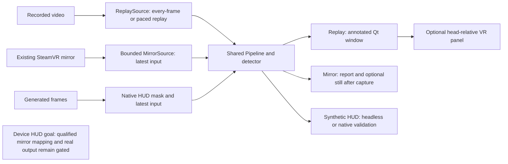

# Architecture

SightCircuit turns recorded or captured images into object names and boxes.
Input, detection and presentation are separate components, so they share a
recognition engine while retaining different operating limits.

Start here for the design. Use [development](development.md) to build it,
[status](status.md) for verified capabilities, and [current work](live-capture.md)
for remaining work. A **head-relative** panel follows the wearer's view; a
**world-locked** label would stay attached to a location in the room.

## Frame processing

Three paths exist today. Solid arrows below show implemented paths; the last
box describes the device HUD goal, whose production gates remain closed.

`FrameSource` supplies owned images and source metadata. `Pipeline` converts
pixels, calls the selected `Detector`, and sends matching results to a `Sink`.
Replay and bounded mirror recognition share this engine. The HUD stage masks
its reserved image region before resizing or inference.

A result always belongs to its original frame. Latest-only processing keeps
one pending input and replaces old input when inference is slower than capture.
Observation time records when the application read a frame; it is not a camera
exposure timestamp. See the [pipeline reference](development.md#python-package-and-pipeline)
for interfaces and module layout.

## Fixed edge HUD decision

The active proof of concept shows up to three object names and approximate
direction arrows in a fixed, head-relative tile at the lower-right edge of the
view. It shows no scene video or world-space labels. The [scope and accepted
decisions](poc-scope.md) own this choice.

The mirror includes our VR output, so the detector must not see the HUD's own
pixels. Before resizing, the HUD stage masks the full footprint, its margin,
and every qualified eye copy at native resolution. It then fills that region
from surrounding scene pixels. The covered region is a blind region where
objects cannot be reliably presented.

The mapping binds the source, session, runtime, tracking origin, image format
and HUD configuration. Changed or expired context stops inference and output;
stale content expires from its original frame time, independently of inference.
Only synthetic calibrations are accepted today. Real mirror input with the HUD,
hardware mapping and real expiring HUD output remain closed in code.

The [qualification design](hud-qualification.md) explains the missing device
evidence. Current [HUD runtime](reference/hud-runtime.md),
[candidate records](reference/hud-candidates.md), [session identity](reference/hud-session.md)
and [observation tools](reference/hud-observation.md) have separate references.
A clean marker observation is still **unqualified**: it cannot establish eye
identity, hidden copies or feedback exclusion by itself.

## Recognition implementation and model replacement

MobileNet-SSD is the default CPU detector. YOLOX-Nano is an implemented
alternative. Models preserve their own labels; evaluation maps them to common
names when appropriate. Neither model has a rug class. A successful command
or a single detected object does not establish broad detection accuracy.

The [detection reference](reference/detection.md) documents preprocessing,
coordinates, the detector interface and the model-replacement procedure.

### Candidate models

See [implemented models and later candidates](reference/detection.md#candidate-models).

### Replacement procedure

See [adding and evaluating a detector](reference/detection.md#replacement-procedure).
Keep representative Frame evaluation separate from the public regression set.

## Camera backend boundary

The working live input is a bounded read from the existing SteamVR composited
mirror. Its physical camera identity, exposure timing and calibration are not
established. It can include our output. A captured-image panel therefore needs
its own exclusion solution; the HUD instead depends on a qualified footprint
mask and feedback validation.

Dedicated camera capture is a deferred, paused track. Its experimental provider
allows metadata inspection only; no synchronized ownership contract permits
pixel reads. A future provider must expose an owned copy through a supported
frame lease or a verified synchronized compositor access window. It is not a
prerequisite for the current HUD path. See the [camera reference](steam-frame-camera.md)
and [provider research](live-capture.md#producer-synchronization-review-and-next-checkpoint).

## Presentation and spatial labels

The replay window receives completed annotated frames from a worker. The Qt
thread owns its displayed image, and an optional sink sends that same result
to a separate OpenVR bridge process. The panel follows the headset and can be
positioned through the [overlay controls](vr-overlay.md).

World-locked labels would require calibrated camera geometry, depth and a
headset pose aligned to the frame's timebase. A 2D box supplies none of those.
They remain deferred until the fixed HUD proof of concept is accepted.

## Optional offline Gaussian splats

Gaussian splats reconstruct scene appearance from recordings; they do not
replace object detection. Reconstruction and headset viewing remain a separate,
unvalidated future experiment. The [camera reference](steam-frame-camera.md#calibration-spatial-labels-and-gaussian-splats)
retains the researched recording workflow.

## Milestones and acceptance checks

Use the [current work and gates](live-capture.md#edge-hud-acceptance-gates)
for the active sequence and [POC acceptance](poc-scope.md#acceptance) for success
criteria. The [historical milestones](history/architecture-2026-11-07.md#milestones-and-acceptance-checks)
retain the earlier replay, panel, world-space and reconstruction acceptance notes.

## Progress summary

<!-- BEGIN progress-summary: generated by scripts/generate_status.py; edit docs/status-data.json and docs/evidence/ -->
Generated from reviewed capability rows and per-entry evidence. The
[historical dashboard](https://claude.ai/artifact/XNPpBHVFUy5Q8JQV9aLaKq)
was a dated snapshot; this table has a reproducible repository source.
[Status](status.md) owns evidence and
[live capture](live-capture.md#current-work-order) owns current work.

| Area | State | Evidence and limits |
| --- | --- | --- |
| Annotated Qt replay window | Device-confirmed | E47 reports 576 frames and reports four labels; label accuracy remains unevaluated; [E47](status.md#e47-recorded-recognition-and-vr-panel-poc-on-frame) |
| Bounded mirror recognition | Rewritten path re-run on Frame; broader accuracy open | The November 3 rerun had labels matching the owner’s view ([E81](status.md#e81-catch-up-session-on-frame-regressions-400-frame-panel-run-mirror-and-wp2-stills)). [Earlier measurements, still export and limits](evidence/capability-notes.md#bounded-mirror-recognition). |
| Candidate detector and evaluation harness | E61 miss reproduced; Frame model choice open | The original still and digest were verified on Frame; the miss remains unexplained ([E80](status.md#e80-file-only-detector-re-run-on-the-e61-still-with-audit-variants)). Five unboxed stills support the chair demo, not a model default. [Evaluation details](evidence/capability-notes.md#candidate-detector-and-evaluation-harness). |
| Fixed edge HUD, marker and offline live pipeline | Offline validation passed; G2 closed; G3 open | The owner accepted rehearsed recovery; the green-input cause is unknown ([E79](status.md#e79-g2-green-input-log-analysis-and-recovery-rehearsal-on-frame)). G3 stopped before any marker ([E83](status.md#e83-g3-marker-observer-attempt-stopped-at-the-observer-scene-precondition)). Production gates stay closed; [implementation and limits](evidence/capability-notes.md#fixed-edge-hud-marker-and-offline-live-pipeline). |
| Stereo depth and world-space labels | Deferred | Calibration, depth and pose/timebase alignment remain unresolved |
| Gaussian splat reconstruction and viewing | Deferred optional work | Recorded-data workflow researched; training and headset splat rendering not validated by this project |

The fixed edge HUD has offline validation. Lifecycle acceptance, Frame
mapping observation/qualification, feedback exclusion, physical expiry and
the 60-second headset acceptance run remain separate gates. World-locked
labels, dedicated capture, depth and splats stay deferred.
<!-- END progress-summary -->
