> **Historical snapshot.** Preserved during the documentation reorganization on
> 2026-11-07. The original dates and later updates below are retained; statements
> about current state, next work, commands and approvals describe their original
> context. Use the [current work plan](../live-capture.md#current-work-order),
> [reviewed status](../status.md) and [documentation index](../README.md) today.

# Video stream reference review and strategy

Reviewed on 2026-10-16. This page preserves the source analysis and strategy
recorded on that date; it is not a live capture result or the active backlog.
Use [live capture](../live-capture.md#current-work-order) for current tasks and
[status](../status.md) for project compatibility and device evidence.

## Recommendation

The recommendation at the review date was to use two paths: a short feasibility test of the **existing composited mirror**
for a first 2D recognition demonstration, followed by an isolated adaptation of
the **Arcturus Vulkan capture components** for camera frames independent of our
display. Prefer a supported vendor interface if one becomes available. Do not
repeat the unchanged public tracked-camera probe.

The mirror is a conditional shortcut: it must already be available, actually
include live passthrough and be verified on this Frame. The dedicated capture
path has the strongest implementation evidence for Arcturus. Neither path has
yet been demonstrated by this project, and built-in camera support remains a
separate question.

## What the references actually provide

| Reference reviewed | Stream evidence | Consequence |
| --- | --- | --- |
| [Hand-tracking report][report] and `capture/` at `ff6a2b2` | Author reports live Arcturus buffers; source implements FD sharing, Vulkan import and luma publication | Best reference for dedicated Arcturus capture; reuse only capture components initially |
| [Investigation log][findings] at the same pin | `/dev/video99` is a final composited mirror; public tracked-camera calls failed | Mirror may suffice for a 2D demo, although it cannot replace calibrated camera input |
| [Passthrough Shortcuts source][switch] at `032841d` | Private get/set calls select RGB or monochrome; no image retrieval | Useful for understanding source selection, not a frame provider |
| [Splat Workshop recording script][workshop] at `a4ef32f` | Reads local MP4 or downloads completed recordings over SSH/SCP | Offline replay/reconstruction only; not a live camera stream |
| [Spirula video module][spirula-video] at `f60271a` and [calibrated manifest support][manifest] at `069fb5e` | File demux/decode and reconstruction metadata | Decoder/reconstruction references, not a headset capture interface |
| [Official Arcturus apps](https://arcturus.vision/apps) and [support](https://arcturus.vision/support) | Viewing, recording, transfer/conversion and reconstruction | No public live-frame contract found on the reviewed pages |

The first three community pins matched their default-branch heads when checked.
For Spirula, `master` points to `f60271a` while `sfm-calibrated-manifest` points to
`069fb5e`. The different default-branch hash is not evidence of a newer version
of the camera-specific branch. The official apps page separately advertises
build `09383f7`; that build was not audited here and does not change this live
capture recommendation. Existing reconstruction pins are unchanged.

## How dedicated Arcturus capture works

```mermaid
flowchart LR
    Camera[Arcturus camera] --> XR[XRService]
    XR --> Compositor[Camera buffers imported by vrcompositor]
    Compositor --> Layer[Small Vulkan layer duplicates buffer FDs]
    Layer --> Socket[Local cam.sock: FDs and image metadata]
    Socket --> GPU[ptgrab: own Vulkan device and queue]
    GPU --> SHM[Shared memory: downscaled grayscale frames]
    SHM --> Reader[SightCircuit capture reader]
    Reader --> Detect[Detector]
    Detect --> Panel[Existing Qt window and VR panel]
```

The layer intercepts external-memory imports, duplicates the file descriptor
before Vulkan consumes it and records image format, dimensions, DRM modifier,
plane pitches/offsets and binding offset. It serves metadata and descriptors
using `SCM_RIGHTS` over `$XDG_RUNTIME_DIR/mrhand/cam.sock`, restricted to the same
user. See [layer import hooks][layer-import] and [socket serving][layer-socket].

`ptgrab` [imports those buffers into its own Vulkan device][importer]. The
reported camera buffers are Qualcomm UBWC-compressed NV12; reading a CPU memory
mapping as ordinary linear NV12 is insufficient. The GPU extracts plane 0 and
downscales it, then the [stream loop][stream] publishes two luma slots to
`/dev/shm/mrhand-pt`. Default output is 640 × 640 per slot. The
[shared-memory header][protocol] carries sequence, observation timestamp, buffer
ID and local frame count. This is an unencoded local image stream, not RTSP,
an HTTP video feed or an MP4 being tailed.

The older [`camsrc.py` reader][cpu-reader] explicitly assumes linear NV12. Use
the Vulkan path for UBWC; do not copy that CPU mapping shortcut for these images.

## Findings that affect our implementation

1. **The current capture tool targets Arcturus.** Its
   [main function][selection] filters for 2464 × 2464 images. The author
   [reports][report] that built-in-camera-sized buffers stayed empty in every
   room-view mode tried. Removing the size filter alone would not establish
   working built-in capture.
2. **Camera identity is inferred.** The stream sorts buffer IDs and divides
   them into two camera groups. The downstream tracker applies opposite
   [90-degree rotations][consumer]. Verify the physical camera, orientation and
   crop on our Frame; do not adopt the author's slot-to-eye mapping as a contract.
3. **Readiness is heuristic.** The producer polls a 16-row strip and copies an
   image after a changed strip becomes stable. Its own GPU completion fence
   does not synchronize with XRService's writes. Upstream explicitly reports
   [missing producer fences/sequences and missed frames][limits]. A shared-memory
   sequence lock can protect the published copy, but cannot prove the original
   camera buffer was complete. Scene motion outside the strip can also go
   unobserved by this change detector.
4. **The sample needs lifecycle work.** `ptgrab` fetches the buffer registry only
   once and does not reconnect when its generation changes. Add bounded socket
   reads, descriptor and image validation, producer-death detection and clean
   resource release. The layer snapshots FD numbers before sending them after
   releasing the registry lock; an adaptation should duplicate snapshot FDs
   while holding that lock and close its copies after sending. Handle partial
   Unix-stream messages. The importer binds at offset zero, so reject nonzero
   binding offsets until they are supported correctly.
5. **Shared-memory correctness includes both ends.** Audit the writer's
   odd/even publication and the reader's memory ordering on ARM64. The sample
   [Python reader][consumer] uses ordinary struct reads around a copy; do not
   treat that alone as a formal cross-process synchronization guarantee. Test
   restarts, truncation and stale mappings as well as steady-state images.
6. **Capture and inference need separate performance checks.** The author
   [reports banding under inference load][contention], with `ptgrab` alone not
   producing that symptom in their A/B test. Begin capture-only, then add a low
   inference rate. Their performance and scheduling choices are not measurements
   of our MobileNet-SSD application.

## Implementation order and acceptance checks

The sequence below records the recommendation at the review date. Current task
state and acceptance criteria are maintained in [the active plan](../live-capture.md#current-work-order).

1. **Time-box mirror feasibility before a layer deployment.** Use inventory to
   identify an existing SteamVR virtual mirror; do not guess a physical camera
   device number, install a loopback driver or activate a new service in this
   check. If the mirror exists and delivers frames, capture for ten seconds
   with our VR panel hidden. Verify physical scene motion and the selected
   passthrough mode, not merely changing game pixels. Test Arcturus and built-in
   passthrough separately where normal UI controls permit. Exit cleanly and
   retain a small report. A missing or unsuitable mirror ends this experiment.
2. **Keep mirror input distinct from camera input.** Label it composited,
   reprojected and potentially containing UI. It provides no validated camera
   calibration or exposure time. For the first test, inspect an explicitly
   requested still after acquisition stops. Feed live results back into VR only
   if our output is demonstrably excluded from the captured view; otherwise
   it can recursively capture its own panel. A crop is not a general solution
   while overlays or the head move. Mirror-only success proves the 2D demo,
   not the dedicated capture backend.
3. **Build the isolated shared-memory reader and a controlled producer.** Use
   the acceptance criteria in the [live capture plan](../live-capture.md). Keep
   that work independent of Vulkan installation. Read one explicitly selected
   slot, validate fresh frames, bound retries and exit on timeout. Test the
   native synchronization path on ARM64 before a headset compatibility claim.
4. **Prepare just the dedicated capture components.** Pin the MIT-licensed
   layer, protocol and `ptgrab`; preserve upstream notices if code is reused.
   Address the lifecycle findings before integration. Do not install hand
   tracking, PC drivers, controller emulation or automatic source switching.
   The [upstream installer][install] requires a subsequent compositor start;
   the [uninstaller][uninstall] does not unload a running layer. Prepare an
   exact configuration backup/restore and controlled runtime trial first.
5. **Prove dedicated live input, then attach the app.** Run a ten-second
   capture-only trial with a small preview and scene motion. Confirm source,
   orientation, fresh-frame rate, shutdown and normal passthrough. Then feed
   one latest frame into the existing detector/window/panel, starting at a
   target of 5 processed fps and increasing only after device measurements.
6. **Add color and broader source support afterward.** Luma can be repeated
   into three channels for the demo detector, with recognition quality measured
   explicitly. Actual color requires UV-plane extraction or verified YCbCr
   sampling, including color matrix/range and chroma placement. Built-in capture
   requires finding buffers that actually update. Stereo depth needs stronger
   timing and calibration evidence than the current heuristic timestamps.

At the review date, the proposed first deliverable was the bounded mirror
diagnostic, followed by the dedicated-camera reader. The review did not add
either tool, send a support message or activate capture software. Later progress
belongs in [status](../status.md) and the [active plan](../live-capture.md).

[report]: https://github.com/spyjacob/steam-frame-hand-tracking/blob/ff6a2b29bc50c9497d66fd7ff07e00b61f9eb082/REPORT.md#L26-L49
[findings]: https://github.com/spyjacob/steam-frame-hand-tracking/blob/ff6a2b29bc50c9497d66fd7ff07e00b61f9eb082/FINDINGS.md#L8-L15
[switch]: https://github.com/KominoVR/frame-passthrough-shortcuts/blob/032841dcde61059b25d33a487bf202a30fbf58f1/src/openvr_camera_source.cpp#L123-L144
[workshop]: https://github.com/thunderheronight/splat-workshop/blob/a4ef32f28aab0b8372c09a8c221ef0f59bfeff4a/scripts/splat.sh#L35-L61
[spirula-video]: https://github.com/arcturus-vision/spirula-studio/blob/f60271a8c006c8f5c6348ad5332fe78ac3da0191/src/video/README.md#L19-L31
[manifest]: https://github.com/arcturus-vision/spirula-studio/blob/069fb5e489fb81c4c8d04b515330851ab88c7965/src/sfm/README.md#L299-L316
[layer-import]: https://github.com/spyjacob/steam-frame-hand-tracking/blob/ff6a2b29bc50c9497d66fd7ff07e00b61f9eb082/capture/handcam_layer.cpp#L311-L340
[layer-socket]: https://github.com/spyjacob/steam-frame-hand-tracking/blob/ff6a2b29bc50c9497d66fd7ff07e00b61f9eb082/capture/handcam_layer.cpp#L173-L234
[importer]: https://github.com/spyjacob/steam-frame-hand-tracking/blob/ff6a2b29bc50c9497d66fd7ff07e00b61f9eb082/capture/ptgrab.cpp#L125-L160
[stream]: https://github.com/spyjacob/steam-frame-hand-tracking/blob/ff6a2b29bc50c9497d66fd7ff07e00b61f9eb082/capture/ptgrab.cpp#L397-L480
[protocol]: https://github.com/spyjacob/steam-frame-hand-tracking/blob/ff6a2b29bc50c9497d66fd7ff07e00b61f9eb082/capture/handcam_proto.h#L30-L44
[cpu-reader]: https://github.com/spyjacob/steam-frame-hand-tracking/blob/ff6a2b29bc50c9497d66fd7ff07e00b61f9eb082/handtrack/camsrc.py#L51-L61
[selection]: https://github.com/spyjacob/steam-frame-hand-tracking/blob/ff6a2b29bc50c9497d66fd7ff07e00b61f9eb082/capture/ptgrab.cpp#L500-L518
[consumer]: https://github.com/spyjacob/steam-frame-hand-tracking/blob/ff6a2b29bc50c9497d66fd7ff07e00b61f9eb082/handtrack/live.py#L139-L172
[limits]: https://github.com/spyjacob/steam-frame-hand-tracking/blob/ff6a2b29bc50c9497d66fd7ff07e00b61f9eb082/REPORT.md#L173-L180
[contention]: https://github.com/spyjacob/steam-frame-hand-tracking/blob/ff6a2b29bc50c9497d66fd7ff07e00b61f9eb082/REPORT.md#L158-L169
[install]: https://github.com/spyjacob/steam-frame-hand-tracking/blob/ff6a2b29bc50c9497d66fd7ff07e00b61f9eb082/capture/install.sh
[uninstall]: https://github.com/spyjacob/steam-frame-hand-tracking/blob/ff6a2b29bc50c9497d66fd7ff07e00b61f9eb082/capture/uninstall.sh
