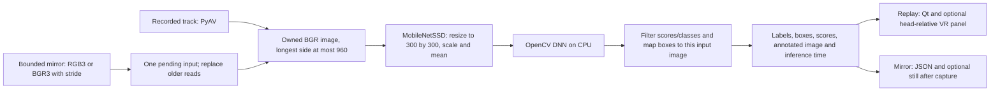

# Detection and model replacement

The implemented detector is [`MobileNetSSD`](../../sightcircuit/detection.py), shared
by file replay and the bounded mirror recognizer through the
[shared pipeline](../../sightcircuit/pipeline.py). It loads SHA-256-verified
MobileNet-SSD Caffe weights/configuration into OpenCV DNN, explicitly selects
CPU execution and limits OpenCV to two threads. It recognizes the 20 Pascal VOC
foreground classes plus a background output; it has no rug class. A rug labeled
sofa is a false positive, not evidence that rug recognition is supported.



Replay converts its selected decoded track to BGR24 and scales it to at most
960 pixels on the longest side. The mirror path handles padded RGB3/BGR3 reads,
converts to BGR and uses the same limit. The detector requires a nonempty
`uint8` image with three BGR channels. Its `blobFromImage` uses a 300 × 300
resize, scale `0.007843` and mean `127.5`; this resize stretches the image, as
in SSD training,
rather than adding letterbox padding. SSD's normalized boxes are mapped back
to the dimensions of that specific input image, clamped and drawn on an owned
copy. The default score threshold is the [POC threshold](#poc-threshold-and-live-budget),
0.5. Scores are not calibrated probabilities or a measured accuracy percentage.

The detector boundary is the `Detector` protocol; drawing is separate:

```python
result = detector.detect(bgr_image, threshold)   # sightcircuit.frame.DetectionResult
# result.detections: (Detection(label, confidence, box_xyxy), ...) in input pixels
# result.labels: sorted label strings
# result.inference_ms: time spent in the model's forward call
image = annotate(bgr_image, result)              # owned annotated copy
```

`Pipeline` performs conversion, detection and annotation for both callers and
hands each `Processed` result (frame, detections, annotated image, input age and
total processing time) to sinks. `create_detector()` selects a registered
detector (`--detector`); a replacement implements the same protocol and
registers its class. Replay presents one latest completed
result, while mirror capture keeps one pending owned input for inference and
drops observations older than one second. The measured 42.044 ms mean forward
time and roughly 5 processed fps belong to the bounded mirror/MobileNet trial,
not to a replacement model or a full live VR pipeline.

YOLOX-Nano instead letterboxes its input: the image is scaled to fit 416 × 416
without distortion, padded at the bottom/right with gray 114, and boxes are
mapped back through the inverse transform (`sightcircuit/preprocess.py`). Its
scores are objectness × class probability after class-aware NMS at IoU 0.45.
Detectors keep native label names in reports (`sofa` for MobileNet-SSD,
`couch` for YOLOX); evaluation compares them through canonical COCO names.

## POC threshold and live budget

Two constants in `sightcircuit/detection.py` carry the proof of concept's
detection contract, so no command or module repeats their numbers:

| Constant | Value | Meaning |
| --- | --- | --- |
| `POC_THRESHOLD` | 0.5 | The score threshold detections must reach. It is the `--threshold` default of `evaluate_detectors.py`, `mirror_recognize.py` and `replay_window.py`, the `threshold` default of `Pipeline`, `run_pipeline` and `run_recognition`, the smoke check's threshold and the mask fill evaluation's scoring threshold, and the threshold the seed pin records. |
| `LIVE_INFERENCE_P95_BUDGET_MS` | 200 | The owner's live budget, accepted on 2026-11-07: the inference p95 of a `mirror_recognize.py` run on the Frame (`pipeline.inference_ms.p95` in its report) may not exceed 200 ms, which is five frames per second. |

Both are read by the [D6 default-detector rule](../poc-scope.md#architecture-decisions-2026-11-07):
chair recall at the POC threshold, per box at IoU 0.5 on the boxed
representative set, with Frame inference time inside the live budget. The
mirror report records `inference_p95_budget_ms` and, once a frame has been
timed, `inference_p95_within_budget`, the run's own p95 against the budget;
only a run on the Frame measures the budget, and a cloud or fixture run's
verdict is not device evidence. Changing either value is a reviewed edit of the
constant and this table, not a command option. `tests/test_detection.py`
checks that every command and engine default is the constant and that no
default repeats the literal.

## Recorded Frame evaluation

[E80](../evidence/e080.md) records a file-only rerun after the original E61
still and its saved digest were found on Frame. Both models still missed the
expected TV at the unchanged 0.5 threshold. All audit variants produced the
same input bytes on that grayscale preview, so the miss remains unexplained
and WP1 stays open.

[E81](../evidence/e081.md) records five private, unboxed stills with owner-given
presence/absence labels. Both models detected the chair and missed the bottle;
the owner switched the POC object to chair. These results do not support a
detector-default decision: WP2 remains open, and thresholds/defaults are unchanged.

## Candidate models

MobileNet-SSD and YOLOX-Nano are implemented. The other rows are candidates
for later evaluation, not installed backends or Frame benchmarks.
The exact weights, export graph and redistribution terms must be checked when
selecting an artifact; a repository license alone does not settle every weight's
terms.

| Candidate | Why consider it | Runtime and tradeoff |
| --- | --- | --- |
| Current MobileNet-SSD | Small working baseline with measured Frame execution | OpenCV DNN CPU; only 20 foreground classes and observed false positives |
| [YOLOX-Nano](https://github.com/Megvii-BaseDetection/YOLOX) | **Implemented candidate** (`--detector yolox-nano`); standard COCO training covers 80 classes | Pinned 0.1.1rc0 ONNX export, letterbox input, grid decoding and class-aware NMS; ONNX Runtime CPU with OpenCV DNN fallback; Apache-2.0 source; limited Frame evaluation recorded in E80/E81, model selection still open |
| [YOLO11n](https://docs.ultralytics.com/models/yolo11/) | Another small 80-class COCO detector with an established export workflow | Export off-device instead of requiring the training stack on Frame; verify ONNX operators/runtime and AGPL-3.0 or applicable commercial licensing |
| [EfficientDet-Lite0](https://ai.google.dev/edge/litert/libraries/task_library/object_detector) | A mobile-oriented alternative, including quantized deployment | Requires a LiteRT/TFLite adapter and verified ARM64 runtime; quantized accuracy and preprocessing need measurement |
| [Grounding DINO](https://github.com/IDEA-Research/GroundingDINO) or [OWLv2](https://huggingface.co/docs/transformers/model_doc/owlv2) | Text-prompted categories such as rug/carpet without the current fixed label list | Much heavier candidates; begin with offline evaluation or an explicit companion-computer experiment before headset deployment |
| A small detector fine-tuned for our target objects | Best route if rugs or a specific set of household objects are essential | Collect/label representative color and grayscale camera images, retain a held-out test set and export a compact model; training happens off-device |

COCO's 80 classes also omit rug/carpet. Switching to a COCO model alone will not
add that category. Use suitable custom training or test an open-vocabulary model
if naming rugs is a requirement. Segmentation models can add object outlines;
a generic segmenter does not automatically supply correct object names. Gaussian
splats concern scene reconstruction and do not replace the detector.

## Replacement procedure

1. Agree on target classes and an annotated evaluation set from representative
   recordings/stills, including rugs and objects previously confused. Measure
   correct classes, missed objects, false positives and box placement.
   `scripts/evaluate_detectors.py` implements the comparison; the committed seed
   set is outdoor regression data, and the representative set is captured on
   Frame ([procedure](../on-device.md#compare-detectors-on-frame-stills)).
2. Add a detector adapter that preserves the method/result boundary above.
   Pin weights and label-map hashes, input dtype/shape, RGB/BGR order,
   normalization, model/runtime versions and licenses. The class owns its
   `model_files()` and structured `preprocessing()` description; registering
   it in `DETECTORS` and pinning its files in `scripts/smoke-assets.json` is
   all the evaluator, smoke check and asset tests need. Record its seed counts
   in `evaluation/seed-expected.json` so CI fails on later regressions. Add the runtime only to
   environments that use it. ONNX Runtime is pinned in the window environment
   for YOLOX; MobileNet-SSD continues to use OpenCV DNN.
3. Perform the new model's own preprocessing/output decoding, score filtering
   and NMS where needed. Invert any letterbox/crop/resize transform before
   returning boxes. Keep the original frame association and owned output image;
   changing a weight filename alone is insufficient.
4. Introduce a shared factory/model selection for both callers and retain
   MobileNet-SSD as the comparison baseline (implemented as
   `create_detector()` and `--detector`). Test decoding, class IDs, finite
   scores, coordinate transforms, empty results and shutdown with the adapter.
5. Compare the models on the same inputs, then benchmark ARM64 startup, memory,
   preprocessing/inference/render times, input age, thermals and passthrough
   behavior. Begin at the existing 5 processed fps target; drop older pending
   input instead of accumulating latency.

CPU is the established inference backend. An ARM64 CPU ONNX runtime or an
[ncnn Vulkan](https://github.com/Tencent/ncnn) adapter is a possible later
deployment choice, subject to graph support and measurement. Vulkan capture
capability does not establish fast or compatible model inference, and GPU
inference may contend with capture and compositing on the headset. Benchmark
capture alone before adding it.
