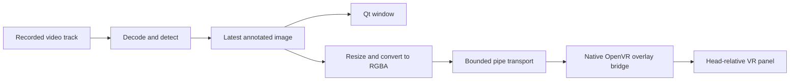

# VR replay panel prototype

Use this guide to build, launch, position and stop the optional replay panel.
[Status and evidence](status.md#e6-window-and-vr-panel) records the user's device
confirmations and unmeasured detection, readability, color and performance limits.
The panel presents a selected recording; live input follows the separate
[capture plan](live-capture.md).

Bounded mirror recognition now runs on Frame with no live display. The
[fixed-panel comparison](on-device.md#check-whether-the-vr-panel-appears-in-mirror-input)
confirmed that the current mirror includes our VR panel. Recorded replay and
snapshots displayed after capture closes remain useful; continuous VR image
output needs input independent of that output, or a supported and validated
exclusion mode. No such mirror mode has been validated. See
[the inclusion evidence](status.md#e18-vr-panel-included-in-mirror-input).

## First device test: a timed panel

Use this test to establish a baseline on a new device or runtime before
launching replay. Prior device observations are recorded in
[status](status.md#e6-window-and-vr-panel).

Close the running replay window so its terminal is available. Keep SteamVR
running and use the normal `steamos` graphical session. On Frame:

```bash
(
  set -e
  cd "$HOME/framejacker"
  git pull --ff-only
  bash scripts/build_overlay_bridge.sh
  artifacts/overlay-bridge/framejacker-overlay-bridge --test-panel --seconds 10
)
```

This builds natively against the same pinned Valve SDK as the camera tool. The
test uses public OpenVR overlay/system interfaces. It does not request a
camera interface, open camera nodes, replace a compositor layer, or change
camera settings. It checks `VRApplication_Overlay` initialization and raw-image
rendering on the actual runtime. The camera probe is not run.

Look for a small panel following your head, slightly below the center of view.
It has a grid, white **TOP** text, red/green upper quadrants and blue/yellow lower
quadrants. It should disappear after ten seconds. Ctrl+C also requests cleanup.
Confirm that passthrough remains working during and after the test. These are
device observations; an API success report alone cannot prove them.

The terminal prints one JSON object per line. `test_panel_submitted` means
`SetOverlayRaw` accepted the image; `api_visible` is SteamVR's visibility flag.
The final object reports `cleanup_ok`, runtime initialization and submitted-frame
count. A passing device test needs both the output and the user's observations.
If the API reports an error or no panel appears, retain the output before
changing the implementation or repeating the test.

## Annotated replay after the panel test passes

The same recording and detector feed both presentations:



```bash
(
  set -e
  cd "$HOME/framejacker"
  bash scripts/setup_window.sh
  .venv-replay/bin/python scripts/replay_window.py --overlay \
    "$HOME/Videos/ArcturusVisionCamera/2026-10-15_21-20-34_stereo.mp4"
)
```

The Qt window gains **Show VR panel**, width, distance, horizontal/vertical
position and opacity controls. They operate through the existing window; the
VR image itself does not accept pointer/controller input. Pause stops replay
frames while panel controls remain active. Hide changes visibility without
stopping the detector. Close the window or use Ctrl+C to end both processes.

Default width is 0.8 m, distance 1.5 m, horizontal offset 0 m, vertical offset
−0.2 m and opacity 0.95. Positive horizontal moves right and positive vertical
moves up. Placement is relative to the HMD, with negative Z forward. It follows
head movement and is not a world-anchored label or a stereo/depth display. Both
eyes receive the same image from one explicitly selected video track.

The runtime owner is a separate native process using `IVROverlay_028`. Images
are tightly packed RGBA, resized to at most 512 × 512; the default replay cap
remains 10 processed fps. This CPU-copy path is a prototype, not a measured
low-latency graphics path. The runtime can reject `SetOverlayRaw`; use its named
error rather than assuming general OpenVR support implies Frame compatibility.
Color appearance, text readability, tracking/compositor impact and performance
need device measurements beyond the confirmed basic playback and controls.

## Shutdown and reports

The native process owns its overlay, hides and destroys it before `VR_Shutdown`,
and responds to stdin EOF, quit packets, SIGINT/SIGTERM and runtime quit events.
Linux parent-death signaling also requests shutdown if the GUI process dies.
The Python client waits for a normal exit, then uses bounded termination if the
bridge stops responding; forced termination is reported and cleanup is marked
unconfirmed. SteamVR normally destroys an application's overlays when that
application disconnects, but verify actual disappearance in the first test.

The Qt exit summary includes an `overlay` section with native cleanup results
and frame counts. Frames are not saved or sent over a network. The existing
explicit preview/report flags still control optional file outputs.

## Transport and cloud verification

The binary protocol uses little-endian `FJO1`, a uint32 opcode, a uint32 payload
length, and a bounded payload. It is private to these two project components.

| Opcode | Payload |
| --- | --- |
| `1`: frame | uint32 width, uint32 height, tightly packed RGBA bytes; each side 1–512 |
| `2`: settings | five float32 values: width, distance, x, y, opacity; then uint32 visibility (0 or 1) |
| `3`: quit | Empty |

Settings ranges match the UI: width 0.25–1.5 m, distance 0.5–3 m, offsets −1–1 m,
opacity 0.2–1. Input rejects nonfinite values and malformed lengths. The sender
retains one pending image; a blocked native upload does not block the Qt thread
or build an unbounded frame queue. Settings heartbeat every second keeps paused
sessions alive. Input idles out after ten seconds, and partial packet reads time
out after three seconds; synchronous OpenVR calls are separate from these bounds.

`--validate-stdin` runs the same parser without initializing OpenVR. Reports
explicitly mark `validation_only: true`, `runtime_initialized: false` and zero
submitted frames. The offscreen integration test uses that mode to exercise the
Qt controls and real anonymous-pipe transport. It cannot validate rendering.

```bash
bash scripts/build_overlay_bridge.sh
.venv-replay/bin/python -m unittest discover -s tests -v
```

With window dependencies and model fixtures installed, this covers valid and
malformed packets, named missing-runtime failure, signal/EOF cleanup, read
timeouts, channel order, resizing, Qt forwarding and the existing replay tests.
