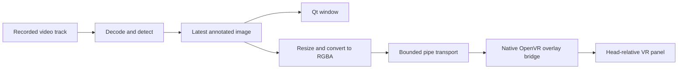

# VR replay panel prototype

Use this guide to build, launch, position and stop the optional replay panel.
For session orchestration use [Frame sessions](guides/frame-sessions.md); for
protocol and lifecycle details use the [overlay reference](reference/overlay.md).
[Status and evidence](status.md#e6-window-and-vr-panel) records the user's device
confirmations and unmeasured detection, readability, color and performance limits.
The [recorded-input POC](status.md#e47-recorded-recognition-and-vr-panel-poc-on-frame)
established visible labels and normal passthrough. The later
[E81 session](evidence/e081.md) submitted all 400 replay frames with a clean
close; the owner saw the picture keep changing to the end, with normal
passthrough and tracking. That bridge used the old connect order. This result
does not qualify the changed lifecycle, HUD-size uploads or a detector default;
[E84](evidence/e084.md) records the later cloud checks and remaining device work.
Label accuracy, measured latency and live input remain separate checks.
The panel presents a selected recording; live input follows the separate
[capture plan](live-capture.md).

Bounded mirror recognition now runs on Frame with no live display. The
[fixed-panel comparison](on-device.md#check-whether-the-vr-panel-appears-in-mirror-input)
confirmed that the current mirror includes our VR panel. Recorded replay and
snapshots displayed after capture closes remain useful. A full-scene live image
panel would need qualified exclusion or independent input; the new edge HUD
instead requires calibrated full-footprint masking as described below. Neither
that masking nor a compositor exclusion mode has been device-validated. See
[the inclusion evidence](status.md#e18-vr-panel-included-in-mirror-input).

## Planned edge HUD

The [fixed edge HUD decision](architecture.md#fixed-edge-hud-decision) is the
approved live-mirror direction. A name and approximate view-relative arrow stay
inside a fixed reserved strip; the full footprint is masked before resizing or
inference. This is a blind region, not a world-locked annotation. Synthetic
implementation and native validation passed
([E69](status.md#e69-offline-edge-hud-and-native-mask-validation)); actual
mapping/calibration, head-motion leakage and physical VR expiry remain pending.
The tile is 320 x 128 with up to three names/arrows and no scene video; fixed
geometry/opacity and expiring transport remain validation-only. The bridge rejects
expiring packets in real output mode. The existing test panel uses different
marker geometry and cannot qualify HUD mapping or physical expiry; synchronous
VR calls also prevent an absolute deadline guarantee. A later separate
[marker-only harness](status.md#e70-offline-marker-only-harness) now generates the
matching opaque HUD marker; its offline-tested output opt-in does not enable
production HUD frames or qualify mapping. The
[recovered V4 evidence](evidence/e075.md) establishes that a marker-only observer
run did execute on Frame and failed: no valid mapping was accepted, and the
wearer reported green Arcturus passthrough before manually switching to native
passthrough. [E79](evidence/e079.md) subsequently closed G2 on the owner's
confirmation of a recovery rehearsal with normal passthrough and tracking.
The green-input cause remains unknown; a rehearsal without green input does
not establish a cure. The later [E83 attempt](evidence/e083.md) stopped at
`observer_contour_budget` before bridge initialization or any marker tile;
G3 remains open and G4 remains unqualified. A clean future
observer result would still be `observed_unqualified` (exit 2), not production
feedback-exclusion qualification. Follow the [current plan](live-capture.md)
and [bounded calibration checkpoint](on-device.md#bounded-edge-hud-calibration-checkpoint)
for that separate work; replay-panel tests do not qualify it.

## First device test: a timed panel

Use this test to establish a baseline on a new device or runtime before
launching replay. The example updates `main`; to test a reviewed detached
revision, omit its `git switch` and `git pull` lines. Prior device observations
are recorded in
[status](status.md#e6-window-and-vr-panel).

Close the running replay window so its terminal is available. Keep SteamVR
running and use the normal `steamos` graphical session. On Frame:

```bash
(
  set -e
  cd "$HOME/sightcircuit"
  git switch main
  git pull --ff-only
  bash scripts/build_overlay_bridge.sh
  artifacts/overlay-bridge/sightcircuit-overlay-bridge --test-panel --seconds 10
)
```

This builds natively against the same pinned Valve SDK as the camera tool. The
test uses public OpenVR overlay/system interfaces. It does not request a
camera interface, open camera nodes, replace a compositor layer, or change
camera settings. It checks `VRApplication_Overlay` initialization and raw-image
rendering on the actual runtime. The camera probe is not run.

Look for a small panel following your head, slightly below the center of view.
It has a grid, white **TOP** text, red/green upper quadrants and blue/yellow lower
quadrants. It should disappear after ten seconds. Ctrl+C also requests cleanup.
Confirm that passthrough remains working during and after the test. These are
device observations; an API success report alone cannot prove them.

The terminal prints one JSON object per line. `test_panel_submitted` means
`SetOverlayRaw` accepted the image; `api_visible` is SteamVR's visibility flag.
The final object reports `cleanup_ok`, runtime initialization and submitted-frame
count. A passing device test needs both the output and the user's observations.
If the API reports an error or no panel appears, retain the output before
changing the implementation or repeating the test.

## Annotated replay after the panel test passes

The same recording and detector feed both presentations:



Choose a completed recording using the [replay guide](guides/replay.md#prepare-a-recording-for-replay).
Replace `REPLACE_stereo.mp4` below with that file's name:

```bash
(
  set -e
  cd "$HOME/sightcircuit"
  bash scripts/setup_window.sh
  .venv-replay/bin/python scripts/replay_window.py --overlay \
    "$HOME/Videos/ArcturusVisionCamera/REPLACE_stereo.mp4"
)
```

The Qt window gains **Show VR panel**, width, distance, horizontal/vertical
position and opacity controls. They operate through the existing window; the
VR image itself does not accept pointer/controller input. Pause stops replay
frames while panel controls remain active. Hide changes visibility without
stopping the detector. Close the window or use Ctrl+C to end both processes.

Default width is 0.8 m, distance 1.5 m, horizontal offset 0 m, vertical offset
−0.2 m and opacity 0.95. Positive horizontal moves right and positive vertical
moves up. Placement is relative to the HMD, with negative Z forward. It follows
head movement and is not a world-anchored label or a stereo/depth display. Both
eyes receive the same image from one explicitly selected video track.

The replay defaults to a cap of 10 processed fps and a panel image of at most
512 × 512 pixels. The runtime can reject `SetOverlayRaw`; retain its named error.
Color appearance, text readability, tracking/compositor impact and performance
need device measurements beyond the confirmed basic playback and controls.

## Shutdown and reports

The native process owns its overlay, hides and destroys it before `VR_Shutdown`,
and responds to stdin EOF, quit packets, SIGINT/SIGTERM and runtime quit events.
Linux parent-death signaling also requests shutdown if the GUI process dies.
The Python client waits for a normal exit, then uses bounded termination if the
bridge stops responding; forced termination is reported and cleanup is marked
unconfirmed. SteamVR normally destroys an application's overlays when that
application disconnects, but verify actual disappearance in the first test.

The Qt exit summary includes an `overlay` section with native cleanup results
and frame counts. Frames are not sent over a network. Explicit preview/report
options control optional local file outputs. Record wearer observations with
the [session observation page](guides/frame-sessions.md#record-headset-observations-for-a-run)
and submit results through [evidence maintenance](evidence/README.md).

### Connect order, output and watchdog (package K, 2026-11-04)

The bridge joins an already running SteamVR. Connection probes, the
`--connect-as background` opt-in, watchdog phases and cloud-test limits are in
the [overlay reference](reference/overlay.md#connect-order-output-and-watchdog-package-k-2026-11-04).
The opt-in has no recorded Frame result and is separate from the default replay procedure.

## Transport and cloud verification

Packet formats, settings ranges, heartbeat and expiry semantics, and offline
validation commands are in the
[overlay reference](reference/overlay.md#transport-and-cloud-verification).
Transport validation does not establish rendering or physical headset recovery.
