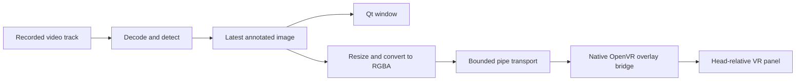

# VR replay panel prototype

Use this guide to build, launch, position and stop the optional replay panel.
[Status and evidence](status.md#e6-window-and-vr-panel) records the user's device
confirmations and unmeasured detection, readability, color and performance limits.
The latest [recorded-input POC](status.md#e47-recorded-recognition-and-vr-panel-poc-on-frame)
processed/presented 576 frames and submitted all 576 VR images, with clean
shutdown. The user confirms visible labels and normal passthrough during/after.
Label accuracy, measured latency/rate and live input remain separate checks.
The panel presents a selected recording; live input follows the separate
[capture plan](live-capture.md).

Bounded mirror recognition now runs on Frame with no live display. The
[fixed-panel comparison](on-device.md#check-whether-the-vr-panel-appears-in-mirror-input)
confirmed that the current mirror includes our VR panel. Recorded replay and
snapshots displayed after capture closes remain useful. A full-scene live image
panel would need qualified exclusion or independent input; the new edge HUD
instead requires calibrated full-footprint masking as described below. Neither
that masking nor a compositor exclusion mode has been device-validated. See
[the inclusion evidence](status.md#e18-vr-panel-included-in-mirror-input).

## Planned edge HUD

The [fixed edge HUD decision](architecture.md#fixed-edge-hud-decision) is the
approved live-mirror direction. A name and approximate view-relative arrow stay
inside a fixed reserved strip; the full footprint is masked before resizing or
inference. This is a blind region, not a world-locked annotation. Synthetic implementation and native validation passed
([E69](status.md#e69-offline-edge-hud-and-native-mask-validation)); actual
mapping/calibration, head-motion leakage and physical VR expiry remain pending.
The tile is 320 x 128 with up to three names/arrows and no scene video; fixed
geometry/opacity and expiring transport remain validation-only. The bridge rejects
expiring packets in real output mode. The existing test panel uses different
marker geometry and cannot qualify HUD mapping or physical expiry; synchronous
VR calls also prevent an absolute deadline guarantee. A later separate
[marker-only harness](status.md#e70-offline-marker-only-harness) now generates the
matching opaque HUD marker; its offline-tested output opt-in does not enable
production HUD frames or qualify mapping. The later
[ARM64 cross-build and empirical observer](status.md#e71-offline-arm64-build-and-empirical-marker-observer)
are prepared offline; the binary has not been executed. Frame runtime dependencies,
mirror-node verification, deployment review and operator approval remain pending.
Clean observer output stays `observed_unqualified` (exit 2), not eye-composition
or production feedback-exclusion qualification. The replay controls and tests below do not qualify this new path or
authorize its deployment. See the [bounded calibration checkpoint](on-device.md#bounded-edge-hud-calibration-checkpoint).

## First device test: a timed panel

Use this test to establish a baseline on a new device or runtime before
launching replay. Prior device observations are recorded in
[status](status.md#e6-window-and-vr-panel).

Close the running replay window so its terminal is available. Keep SteamVR
running and use the normal `steamos` graphical session. On Frame:

```bash
(
  set -e
  cd "$HOME/framejacker"
  git pull --ff-only
  bash scripts/build_overlay_bridge.sh
  artifacts/overlay-bridge/framejacker-overlay-bridge --test-panel --seconds 10
)
```

This builds natively against the same pinned Valve SDK as the camera tool. The
test uses public OpenVR overlay/system interfaces. It does not request a
camera interface, open camera nodes, replace a compositor layer, or change
camera settings. It checks `VRApplication_Overlay` initialization and raw-image
rendering on the actual runtime. The camera probe is not run.

Look for a small panel following your head, slightly below the center of view.
It has a grid, white **TOP** text, red/green upper quadrants and blue/yellow lower
quadrants. It should disappear after ten seconds. Ctrl+C also requests cleanup.
Confirm that passthrough remains working during and after the test. These are
device observations; an API success report alone cannot prove them.

The terminal prints one JSON object per line. `test_panel_submitted` means
`SetOverlayRaw` accepted the image; `api_visible` is SteamVR's visibility flag.
The final object reports `cleanup_ok`, runtime initialization and submitted-frame
count. A passing device test needs both the output and the user's observations.
If the API reports an error or no panel appears, retain the output before
changing the implementation or repeating the test.

## Annotated replay after the panel test passes

The same recording and detector feed both presentations:



```bash
(
  set -e
  cd "$HOME/framejacker"
  bash scripts/setup_window.sh
  .venv-replay/bin/python scripts/replay_window.py --overlay \
    "$HOME/Videos/ArcturusVisionCamera/2026-10-15_21-20-34_stereo.mp4"
)
```

The Qt window gains **Show VR panel**, width, distance, horizontal/vertical
position and opacity controls. They operate through the existing window; the
VR image itself does not accept pointer/controller input. Pause stops replay
frames while panel controls remain active. Hide changes visibility without
stopping the detector. Close the window or use Ctrl+C to end both processes.

Default width is 0.8 m, distance 1.5 m, horizontal offset 0 m, vertical offset
−0.2 m and opacity 0.95. Positive horizontal moves right and positive vertical
moves up. Placement is relative to the HMD, with negative Z forward. It follows
head movement and is not a world-anchored label or a stereo/depth display. Both
eyes receive the same image from one explicitly selected video track.

The runtime owner is a separate native process using `IVROverlay_028`. Images
are tightly packed RGBA, resized to at most 512 × 512; the default replay cap
remains 10 processed fps. This CPU-copy path is a prototype, not a measured
low-latency graphics path. The runtime can reject `SetOverlayRaw`; use its named
error rather than assuming general OpenVR support implies Frame compatibility.
Color appearance, text readability, tracking/compositor impact and performance
need device measurements beyond the confirmed basic playback and controls.

## Shutdown and reports

The native process owns its overlay, hides and destroys it before `VR_Shutdown`,
and responds to stdin EOF, quit packets, SIGINT/SIGTERM and runtime quit events.
Linux parent-death signaling also requests shutdown if the GUI process dies.
The Python client waits for a normal exit, then uses bounded termination if the
bridge stops responding; forced termination is reported and cleanup is marked
unconfirmed. SteamVR normally destroys an application's overlays when that
application disconnects, but verify actual disappearance in the first test.

### Connect order, output and watchdog (package K, 2026-11-04)

Every runtime mode (`--test-panel`, `--stdin`, `--calibration-marker`) joins an
already running SteamVR only. (The read-only `--headset-view-record` mode
stops after the Background probe; see
[the prediction cross-check](hud-qualification.md#geometric-prediction-cross-check-2026-11-04).)

1. `VR_Init` as `VRApplication_Background`. A Background client never starts a
   vrserver. If it fails, the bridge exits with one JSON report whose `error` is
   `vrserver_not_running:<VRInitError symbol>` and never attempts the Overlay
   connect.
2. Otherwise the probe is shut down and the bridge connects as
   `VRApplication_Overlay`, up to three attempts 250 ms and 500 ms apart. Each
   retry re-probes first; a server that went away ends the run as
   `vrserver_lost_before_overlay_connect:<symbol>`. A server that exits in the
   short window between a probe and the Overlay `VR_Init` can still be started
   by that call: the window is narrowed, not closed.

The final report's `connect` object records the probes, the probe result, the
Overlay attempts and their errors.

**Background-only opt-in (owner decision, 2026-11-04).** frame-passthrough-pip's
source says a Background client gets the full `IVROverlay`. If that holds on
Frame, step 2 is unnecessary. To test it, a runtime mode may end with
`--connect-as background`: the bridge then keeps the Background client as its
connection and never connects as Overlay (`connect.sequence` is
`background_only_opt_in`, `application_type` `VRApplication_Background`).
`--connect-as overlay` is the default and is refused, like `background`, by
the validation-only and view-record modes. The device check is a person-run
`--test-panel --seconds 10 --connect-as background` with the owner wearing the
headset, then the HUD, `SetOverlayRaw` and overlay-event checks listed below;
it needs the owner's approval and has not run. Until a Frame result exists the
Python clients keep the default. The validation-only modes make no OpenVR
call and carry no `connect` object.

The bridge keeps a duplicate of the real stdout for the JSON protocol and points
fd 1 at stderr before anything can load the SDK, so SDK output cannot corrupt a
report. A SIGALRM watchdog (6 s for the connect, 5 s for any one loop step,
re-armed per step, and 5 s for cleanup) writes one prepared JSON error
(`watchdog_expired:<phase>`, exit code 124, `cleanup_ok: false`) and calls
`_exit` without running cleanup. It sits beside `framejacker/runtime/guard.py`
and the Python client's bounded termination; it does not replace them. A torn
protocol line is terminated before the watchdog line, so the last line always
parses. The handler pattern is adapted from frame-testbench (MIT; see
[THIRD_PARTY](../THIRD_PARTY.md#overlay-bridge-lifecycle)).

The connect order follows the idea in coah80/framecorder
[`src/openvr.rs` L11-L21](https://github.com/coah80/framecorder/blob/130840c871d3fa740fcf494f96ba046b29d76cf4/src/openvr.rs#L11-L21)
and Sippbox/frame-passthrough-pip
[`src/app/main.cpp` L94-L110](https://github.com/Sippbox/frame-passthrough-pip/blob/babae0b9d8f1a0955207bcca3d91c4db6e2474b2/src/app/main.cpp#L94-L110);
no code was copied. Upstream reports that a SteamVR server started outside its
launcher leaves the Frame black or stuck on passthrough. That is a third-party
claim, not Framejacker evidence.

Cloud checks cover the no-server refusal in every mode (with and without
`--connect-as background`), the validation modes and scripted fakes of the
connect order, isolation and watchdog (`tests/test_overlay_bridge.py`). Not yet checked on Frame (each needs the
owner's approval): that the HUD, `SetOverlayRaw` and overlay events behave as
before under the new connect order, and a `SetOverlayRaw` soak past 300 calls at
HUD size (see [G6 risks](live-capture.md#risks)).

The Qt exit summary includes an `overlay` section with native cleanup results
and frame counts. Frames are not saved or sent over a network. The existing
explicit preview/report flags still control optional file outputs.

## Transport and cloud verification

The binary protocol uses little-endian `FJO1`, a uint32 opcode, a uint32 payload
length, and a bounded payload. It is private to these two project components.
The opcodes, layouts and frame-side limit below are defined once in
`framejacker/hud/contract.py`, and the settings ranges in
`framejacker/overlay.py` (`PANEL_LIMITS`); the bridge reads both from the
generated [`tools/hud_contract.hpp`](development.md#generated-hud-contract-header).
The ten- and three-second input timeouts are the bridge's own.

| Opcode | Payload |
| --- | --- |
| `1`: frame | uint32 width, uint32 height, tightly packed RGBA bytes; each side 1–512 |
| `2`: settings | five float32 values: width, distance, x, y, opacity; then uint32 visibility (0 or 1) |
| `3`: quit | Empty |
| `4`: expiring frame (validation-only) | uint64 absolute `CLOCK_MONOTONIC` nanosecond expiry, uint32 width/height, RGBA bytes |

Settings ranges match the UI: width 0.25–1.5 m, distance 0.5–3 m, offsets −1–1 m,
opacity 0.2–1. Input rejects nonfinite values and malformed lengths. The sender
retains one pending image; a blocked native upload does not block the Qt thread
or build an unbounded frame queue. Settings heartbeat every second keeps paused
sessions alive. Input idles out after ten seconds, and partial packet reads time
out after three seconds; synchronous OpenVR calls are separate from these bounds.

`--validate-stdin` runs the same parser without initializing OpenVR. Reports
explicitly mark `validation_only: true`, `runtime_initialized: false` and zero
submitted frames. The offscreen integration test uses that mode to exercise the
Qt controls and real anonymous-pipe transport. It cannot validate rendering.

The synthetic pipeline uses opcode 4 and requires the bridge's
`frame_expiry_supported` handshake. Expiry is derived from source observation
time, capped at one second; already-expired arrivals are dropped. The native
loop checks it during every input wait (20 ms polling, subject to scheduling),
including partial-header/payload waits. Heartbeats change settings only; they
cannot extend the deadline or revive expired content. A fresh frame replaces
the previous expiry. `frame_expired` events and final presentation fields report
software state; `presentation_state_scope` explicitly disclaims headset evidence.
Expiry is separate from the three/ten-second transport timeouts.

Both Python and the bridge reject opcode 4 for real output. Existing replay
opcode 1 and paused-replay behavior remain available under their existing
authorization. Tests of the new expiry use `--validate-stdin` exclusively; a
stalled native process, blocked API call or stuck kernel I/O can prevent timely
expiry, and no real-time bound or headset hide result is claimed.

```bash
bash scripts/build_overlay_bridge.sh
.venv-replay/bin/python -m unittest discover -s tests -v
```

With window dependencies and model fixtures installed, this covers valid and
malformed packets, named missing-runtime failure, signal/EOF cleanup, read
timeouts, channel order, resizing, Qt forwarding and the existing replay tests.
